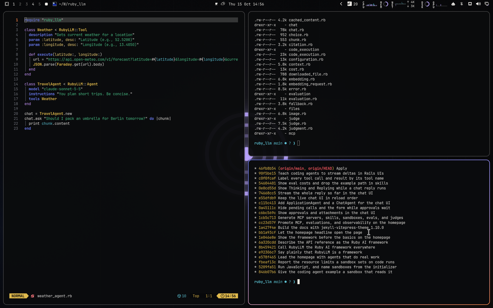

# Solco Dark for Omarchy Quattro

A booth-dark theme with Solco's violet and its blue to orange glow, sampled from the getsolco.com design.



## Install

```bash
omarchy theme install https://github.com/crmne/omarchy-solco-dark-theme.git
```

Activate it with:

```bash
omarchy theme set solco-dark
```

## Architecture

This is a declarative Omarchy Quattro theme. It provides only:

- A semantic palette in `colors.toml`
- A GNOME icon theme choice in `icons.theme`
- Wallpapers in `backgrounds/`
- A selector preview in `preview.png`
- A boot unlock logo in `unlock.png`, with its selector preview in
  `preview-unlock.png`

Omarchy generates and applies the terminal, shell, Hyprland, editor, browser,
Obsidian, keyboard, and btop integrations from the semantic palette. The theme
contains no executable hooks, package installation, or application-specific
configuration files.

## Core colors

Sampled from the design tokens of [getsolco.com](https://getsolco.com).

- Accent: `#b9a3ff`
- Muted: `#74777e`
- Background: `#0a0b0d`
- Surface: `#16181c`
- Foreground: `#eceae6`
- Secondary text: `#a9abb0`

## Wallpapers

Original wallpapers made for this theme from the brand's own artwork:

- `01-grooves.jpg`: The Solco record-groove mark centred with a soft violet glow on a faint beatgrid (bar lines every 4 beats), blue/orange corner glows from the hero
- `02-waveform.jpg`: The site's three-band DJ waveform (blue lows, orange mids, cream highs) across the centre on a beatgrid with a red downbeat, fading at both ends
- `03-vinyl.jpg`: A record seen from above, fine grooves lit by the blue-violet-orange gradient, the mark as its violet label

## Requirements

Omarchy 4 (Quattro) or newer.

## License

[MIT](LICENSE)
